```mermaid
flowchart LR
    U[Untrusted Input / API / LLM Output] --> R1[Ring 1: Schema & Boundary Gate]
    R1 -->|Zod Strict + Sanitization| R2[Ring 2: Auth & Resource Ownership]
    R2 -->|RLS + IDOR Verification| R3[Ring 3: Zero-Injection Execution]
    R3 -->|Parameterized SQL / Safe Exec| R4[Ring 4: Secret & PII Redaction]
    R4 -->|Gitleaks + Clean Logs| R5[Ring 5: Hardened HTTP Headers & Trust]
```

<div align="center">

# Security & Hardening (`security-and-hardening`)

**Zero-Trust AppSec, STRIDE Threat Modeling, OWASP Web/LLM Defense & Secret Leak Prevention**  
*The Enterprise Cybersecurity & User-Trust Protection Standard for AI Coding Agents.*

[](https://github.com/Skill-AI-private/security-and-hardening)
[](https://github.com/Skill-AI-private/security-and-hardening)
[](https://github.com/Skill-AI-private/security-and-hardening)
[](https://github.com/Skill-AI-private/security-and-hardening)
[](https://github.com/Skill-AI-private/security-and-hardening)
[](LICENSE)

<br/>



</div>

---

## Why This Exists: Protecting User Trust at All Costs

Features attract users, but **security and privacy retain their trust**. A single leaked API key, unauthorized record exposure (IDOR), or injection flaw permanently destroys user confidence. Default AI coding assistants frequently optimize for "making code work quickly" while introducing severe security holes.

| Security Risk | Standard AI Agent Behavior | With Security & Hardening (`v2.0`) |
| :--- | :--- | :--- |
| **Secret & Key Exposure** | Hardcodes API tokens in config files or exposes private keys via `NEXT_PUBLIC_*` client variables. | **Zero-Leak Enforcement (`Gitleaks` / `TruffleHog`):** Strictly isolates secrets on the server and scans diffs before every commit. |
| **Broken Access Control (IDOR)** | Checks if a user is logged in, but forgets to verify if that user actually *owns* the requested record. | **Mandatory Ownership Gate:** Enforces `resource.ownerId === session.userId` and Database Row Level Security (RLS) on every mutation. |
| **Injection & Unsafe Execution** | Interpolates strings into SQL queries, shell commands (`exec`), or `dangerouslySetInnerHTML`. | **SAST Hardening (`Semgrep` Rules):** Enforces parameterized queries, `execFile` with `shell: false`, and strict Zod boundary schemas. |
| **AI & Prompt Injection Risks** | Trusts LLM outputs blindly or puts sensitive system credentials inside the model context window. | **OWASP LLM Top 10 Defense:** Treats model output as untrusted input, sandboxes tool calls, and enforces rate/token caps. |
| **Supply-Chain Compromise** | Installs unverified or hallucinated npm/PyPI packages ("slopsquatting") without checking CVEs. | **Supply-Chain Gate (`Trivy` / `OSV`):** Verifies package provenance, locks dependency versions, and audits reachable CVEs. |

---

## The 5-Ring Defense-in-Depth Architecture

```text
==========================================================================================
                    SECURITY & HARDENING ARCHITECTURE MATRIX
==========================================================================================

  [RING 1] THREAT MODELING & BOUNDARY VALIDATION (OWASP WEB TOP 10)
           ├── STRIDE threat analysis across all entry points before writing code
           ├── Strict runtime schema validation (Zod .strict()) at every API/Action gate
           └── SSRF protection blocking loopback, link-local (169.254.169.254) & private IPs

  [RING 2] AUTHENTICATION, SESSIONS & RESOURCE AUTHORIZATION
           ├── Password hashing via Argon2 / Scrypt / Bcrypt (>= 12 rounds)
           ├── Session cookies locked with httpOnly, Secure, and SameSite=Lax/Strict
           └── Mandatory resource ownership verification preventing IDOR & privilege escalation

  [RING 3] ZERO-LEAK SECRET & CREDENTIAL DEFENSE (GITLEAKS & TRUFFLEHOG)
           ├── Strict server-vs-client environment variable separation (no NEXT_PUBLIC secrets)
           ├── Pre-commit staged diff scanning for API keys, tokens, and private keys
           └── Automatic redaction of credentials, tokens, and PII from server error logs

  [RING 4] SUPPLY-CHAIN & AI AGENT SECURITY (TRIVY, SEMGREP & OWASP LLM TOP 10)
           ├── Lockfile integrity enforcement and high/critical CVE reachability auditing
           ├── Prompt Injection & Insecure Output Handling defense for LLM/Agent features
           └── Human-in-the-loop confirmation gates for destructive filesystem/DB operations

  [RING 5] USER-TRUST GOVERNANCE, PRIVACY & HTTP HARDENING
           ├── Production HTTP Security Headers (CSP, HSTS, X-Frame-Options: DENY, nosniff)
           ├── Privacy-by-Design data minimization & true cascading account/data deletion
           └── Standardized SECURITY.md transparency policy for user confidence
==========================================================================================
```

---

## Sample Security Audit Output

When invoked to review code or verify a feature before launch, the skill produces an actionable, deterministic **Cloudflare 4-Phase Security Audit Report**:

```markdown
## Security & Trust Audit Report

### Threat Surface Summary
- **Critical:** 0  |  **High:** 1 (Fixed)  |  **Medium:** 0  |  **Secret Leaks:** 0

### Remediated Findings
#### [HIGH] Potential IDOR in Document Deletion Endpoint
- **Location:** `src/app/api/documents/[id]/route.ts:28`
- **Risk:** Endpoint verified authentication (`session.user`) but deleted `params.id` without verifying `document.ownerId === session.user.id`.
- **Remediation Applied:** Added explicit ownership filter in the database query and verified RLS `DELETE` policy.

### User-Trust Verification Checklist
- [x] Zero secrets or private keys in source code or `NEXT_PUBLIC_*` bundle
- [x] All external inputs validated via strict Zod schemas
- [x] HTTP Security Headers (CSP, HSTS, X-Frame-Options) active
- [x] Dependency lockfile audited (`0` high/critical vulnerabilities)
```

---

## Installation

### Windows (PowerShell)
```powershell
git clone https://github.com/Skill-AI-private/security-and-hardening.git "$HOME\.gemini\config\skills\security-and-hardening"
```

### macOS & Linux (Bash)
```bash
git clone https://github.com/Skill-AI-private/security-and-hardening.git ~/.gemini/config/skills/security-and-hardening
```

---

## Directory Layout

```text
security-and-hardening/
|-- SKILL.md                                                 # Core Zero-Trust & 5-Ring Security Protocol
|-- README.md                                                # Technical specification & architecture
`-- references/                                              # Progressive disclosure security playbooks
    |-- hardening-patterns.md                                # Concrete code patterns (Injection, Auth, XSS, SSRF)
    |-- 02-secret-scanning-and-supply-chain-defense.md       # Gitleaks, TruffleHog, Semgrep SAST & Trivy rules
    |-- 03-cloudflare-audit-and-ai-agent-security.md         # Cloudflare 4-Phase Audit & OWASP LLM Top 10
    `-- 04-user-trust-and-security-md-template.md            # Next.js Security Headers, Privacy & SECURITY.md
```

---

## Acknowledgments & Security Standards

Synthesized from the industry's leading open-source security authorities:
* **Web & AI Security Standards:** `OWASP Top 10 (Web & LLM 2025)` & `STRIDE Threat Modeling`
* **Static Analysis & Secret Scanning:** `semgrep/semgrep`, `gitleaks/gitleaks`, and `trufflesecurity/trufflehog`
* **Supply-Chain Verification:** `aquasecurity/trivy` & `google/osv-scanner`
* **Agentic Security Auditing:** `cloudflare/security-audit-skill`, `agentnode-dev/skills-security-audit`, and `addyosmani/agent-skills`

---

<div align="center">

*Part of the Skill-AI-private Autonomous Software Engineering Suite.*

</div>
